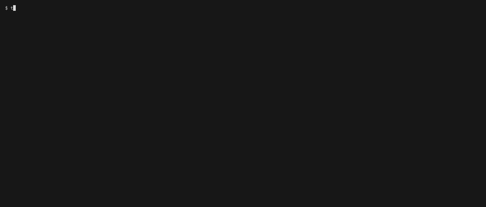

# tenken

[](https://github.com/hidetzu/tenken/actions/workflows/ci.yml)
[](LICENSE)



tenken (点検, "inspection") checks a web site in one run and fails your CI when the site has a problem.

## Features

- Five checks in one run: TLS certificate, redirects, broken links (including mixed content), security headers, and sitemap / `robots.txt`
- One static binary: no browser, no service, no account
- Made for CI: fails the job when there are `fail` findings (or warnings, with `--fail-on warn`), and says so when it could not check — never "fine". The exit codes are in [`docs/cli-reference.md`](docs/cli-reference.md) §4
- Text or JSON output, with a fixed JSON schema
- Says what it did not check: URLs not fetched, limits hit, checks skipped
- Polite and bounded: obeys the start site's `robots.txt` and `Crawl-delay`, one request at a time per host, and a time limit for the whole run

## Install

```sh
go install github.com/hidetzu/tenken/cmd/tenken@latest
```

To install a specific version, name it instead of `@latest`:

```sh
go install github.com/hidetzu/tenken/cmd/tenken@v0.1.0-dev.1
```

It needs the Go version named in [`go.mod`](go.mod) or newer.

## Usage

```sh
tenken https://example.com
```

Exit code `0` means nothing reached `--fail-on` among what was checked: a limit reached, URLs not fetched and
checks that did not run or stopped part-way do not change it (see [`docs/cli-reference.md`](docs/cli-reference.md) §4).

For every flag, rule, exit code and the JSON schema, see [`docs/cli-reference.md`](docs/cli-reference.md).
tenken reads the HTML the server sends: it does not run JavaScript and sends no credentials, so links
built by scripts and pages behind a login are not checked.

## Security

tenken fetches the URL you give it, and on that one host it also connects to private addresses when the host is
one (a private IP, `localhost`, or a name whose first answer is only private addresses), so a local or intranet
site can be checked. Give it URLs you trust: in CI, do not pass a URL that someone outside can choose.
Other hosts are never connected to at a private address, except through a proxy: a request through `HTTP_PROXY` /
`HTTPS_PROXY` is not checked, because the proxy connects ([`docs/cli-reference.md`](docs/cli-reference.md) §3.6, §5.2).
